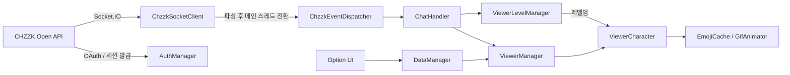

# ChzzkChat

> 치지직(CHZZK) 채팅·후원·구독을 **데스크톱 위를 돌아다니는 캐릭터와 말풍선**으로 보여주는 Unity 오버레이 앱

방송 화면 위에 투명 창으로 띄워 두면, 채팅을 친 시청자마다 캐릭터가 생성되어 말풍선으로 채팅을 보여주고, 후원·구독·레벨업 같은 이벤트에는 전용 애니메이션으로 반응합니다.

> 이 저장소는 포트폴리오용으로 **직접 작성한 스크립트만** 담고 있습니다. 외부 라이브러리·에셋·씬·프리팹은 포함하지 않으므로 이 상태로 바로 빌드되지는 않습니다.

## 주요 기능

| | |
|---|---|
| **실시간 이벤트** | CHZZK Open API OAuth 로그인 → Socket.IO 세션 연결 → 채팅 / 후원 / 구독 이벤트 구독 |
| **캐릭터 오버레이** | 투명 창 위에서 자동 이동, 드래그, 영역 밖에서 놓으면 낙하·착지, 이벤트별 애니메이션 |
| **이모티콘** | 정적 이모티콘과 **GIF**를 말풍선 안에 인라인 렌더링 (외부 라이브러리 없는 자체 GIF 디코더) |
| **시청자 레벨링** | 채팅·후원·팔로우로 경험치 획득, 레벨업 연출, 암호화된 로컬 저장 |
| **런타임 커스터마이징** | 앱 안에서 캐릭터 추가/삭제, 상태별 이미지·FPS·크기·말풍선 위치 편집 (파일 탐색기 연동) |

## 아키텍처



1. `AuthManager`가 로컬 콜백 서버로 OAuth 코드를 받아 토큰을 발급하고, 리프레시 토큰을 AES로 암호화해 저장합니다. 다음 실행부터는 브라우저 없이 자동 갱신합니다.
2. `ChzzkSocketClient`가 세션 URL로 Socket.IO에 접속하고 이벤트를 구독합니다. 소켓 스레드에서 받은 이벤트는 메인 스레드로 넘긴 뒤 `ChzzkEventDispatcher`로 전달합니다.
3. `ChatHandler`가 이벤트를 `ViewerManager`(캐릭터 스폰·말풍선)와 `ViewerLevelManager`(경험치)에 나눠 전달합니다.

## 폴더 구조

```
Assets/
├─ Input/                     입력 액션 정의 (Input System)
└─ Scripts/
   ├─ Core/                   앱 진입점과 공통 매니저
   │   ├─ AppBootstrap          설정 로드, 해상도 복원
   │   ├─ Managers              매니저 초기화 순서 관리
   │   ├─ Singleton             MonoBehaviour / 순수 C# 싱글턴
   │   ├─ ResourceManager       Resources 캐시, 로드/인스턴스화
   │   ├─ CancellationTokenManager  작업별 취소 토큰 관리
   │   └─ InputManager          Input System → UniRx 스트림
   ├─ Auth/                   인증과 보안
   │   ├─ AuthManager           OAuth 로그인, 토큰 갱신/저장
   │   ├─ ConfigManager         Client ID/Secret 암호화 저장
   │   └─ AesCrypto             AES-256-CBC 헬퍼
   ├─ Network/                CHZZK 연동
   │   ├─ ChzzkSocketClient     세션 발급, Socket.IO, 이벤트 구독
   │   ├─ ChzzkEventDispatcher  이벤트 허브
   │   └─ ChatHandler           이벤트 → 캐릭터/레벨 처리
   ├─ Viewer/                 시청자 캐릭터
   │   ├─ ViewerManager         스폰, 인원 제한, 타입별 설정 반영
   │   ├─ ViewerCharacter       이동·드래그·낙하·스프라이트 애니메이션·말풍선
   │   ├─ ViewerLevelManager    경험치/레벨 계산과 저장
   │   ├─ ChatBubble            말풍선 컴포넌트
   │   └─ CharacterAnimationPlayer
   ├─ Emoji/                  이모티콘 파이프라인
   │   ├─ EmojiCache            다운로드·캐시, TMP SpriteAsset 런타임 생성
   │   ├─ GifDecoder            순수 C# GIF 디코더 (LZW, 인터레이스, disposal)
   │   ├─ GifAnimator           TMP 인라인 GIF 재생
   │   └─ GifImage              RawImage GIF 재생
   ├─ Data/                   데이터 모델과 저장
   │   ├─ DataManager           앱 설정·캐릭터 CRUD, 변경 이벤트
   │   ├─ AppData               채팅 설정 (JSON)
   │   ├─ CharacterAnimationData  상태별 이미지/FPS/표시 설정
   │   └─ ResourcePathConfigSO  Resources 경로 자동 수집 (에디터)
   ├─ UI/                     UI 프레임워크와 화면
   │   ├─ UIBase / UIManager    레이어·정렬 순서 기반 UI 스택
   │   ├─ Popups/               알림, 종료, 크레딧
   │   └─ Options/              옵션 창 (일반 / 캐릭터 표시 / 애니메이션)
   └─ Utils/                  확장 메서드, 유틸, Windows 파일 대화상자
```

## 구현 포인트

- **비동기 흐름** — UniTask로 로그인, 토큰 갱신, 다운로드, 파일 대화상자를 모두 async/await로 구성하고, 소켓 콜백은 메인 스레드로 안전하게 전환합니다.
- **자체 GIF 디코더** — 접두어/접미어 테이블 방식 LZW로 코드마다 배열을 할당하지 않으며, 인터레이스와 프레임 disposal 방식을 처리합니다.
- **이모티콘 렌더링** — 이모티콘 하나당 `TMP_SpriteAsset`을 만들어 fallback 체인으로 연결하고, GIF는 프레임마다 스프라이트 시트를 교체해 인라인으로 움직이게 합니다. 같은 이모티콘의 동시 다운로드는 하나로 합칩니다.
- **보안** — 토큰과 설정 파일은 AES로 암호화해 저장하며, 키는 소스에 두지 않고 기기 고유 값에서 파생하고, OAuth `state` 검증으로 CSRF를 막습니다. 토큰 응답은 로그에 남기지 않습니다.
- **메모리/할당 관리** — 프레임마다 도는 로직(`ViewerCharacter`)에서 문자열·배열 할당을 제거하고, 런타임에 만든 텍스처/스프라이트는 교체·파괴 시점에 해제합니다.
- **느슨한 결합** — 이벤트 허브(`ChzzkEventDispatcher`), UniRx 스트림, `IDragItem`·`IOptionPage` 인터페이스로 화면과 로직을 분리했습니다.

## 기술 스택

Unity 6 (6000.1) · C# · UniTask · UniRx · DOTween · TextMesh Pro · Unity Input System · Newtonsoft.Json · SocketIOUnity · UniWindowController (창 투명화)

## 실행하려면

저장소에는 외부 에셋이 없으므로 직접 구성해야 합니다.

1. Unity 6000.1 프로젝트를 만들고 `Assets/`를 복사합니다.
2. 위 기술 스택의 패키지를 설치합니다.
3. 씬에 `Managers`, `AppBootstrap` 등 매니저 오브젝트와 UI 프리팹을 구성합니다.
4. [CHZZK 개발자 센터](https://developers.chzzk.naver.com)에서 애플리케이션을 등록하고 Redirect URI를 `http://localhost:8080/callback`으로 설정합니다.
5. `AppBootstrap`의 `firstTimeSetup`을 켠 채 Client ID/Secret을 입력해 한 번 실행하면 암호화된 `config.bin`이 만들어집니다. 이후에는 끕니다.

> Client ID/Secret은 소스에 포함되어 있지 않으며, 절대 커밋하지 마세요.
